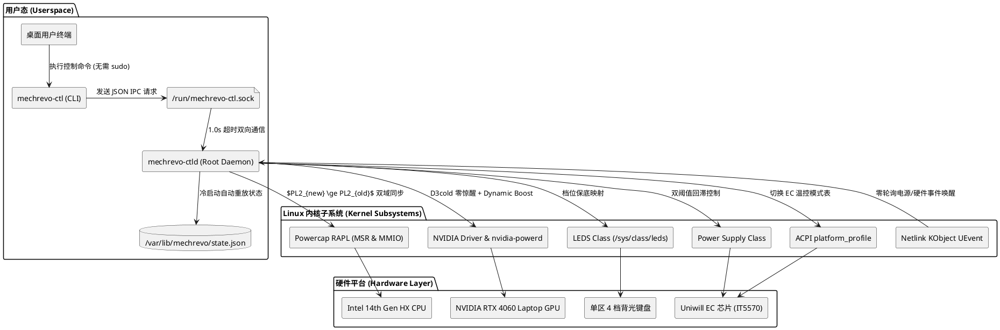

# 机械革命 极光X (GM6IQ0C) Linux 控制台工业级原生工具集 (mechrevo-ctl Rust)

专为 **机械革命 极光X（MECHREVO JiguangX Series，内部代号 GM6IQ0C，i7-14650HX + RTX 4060）** 及同方/Uniwill GM6 系列模具定制的原生 Rust 工业级控制台工具集，用于完整替代 Windows 官方电竞控制台 (`GamingCenter3`)。

本项目严格基于 Linux 内核设备驱动架构（ACPI, Powercap RAPL, Netlink UEvent, NVML/SMI, LEDS）设计，遵循 Linux 内核低功耗与并发时序安全规范，采用纯 Rust 编写，具备内存安全、零运行时开销、瞬时启动与纳秒级响应。



---

## 一、 工业级内核特性

1. **时序安全防倒挂与 RAPL 双域同步 (Anti-Inversion & Dual-Domain MSR/MMIO)**：
   - 升档严格执行 **“先抬 PL2、再提 PL1”**，降档严格执行 **“先压 PL1、再降 PL2”**，杜绝违背物理时序导致内核拒写或 CPU P-Unit 降频锁死。
   - 针对 Intel 14 代 HX 架构同时同步写入 MSR (`intel-rapl`) 与 MMIO (`intel-rapl-mmio`)，击穿 P-Unit $\min(MSR, MMIO)$ 的 45W 默认限制，真正释放 105W 狂暴性能。
2. **零轮询能耗友好型守护进程 (Zero-Polling Event-Driven Daemon)**：
   - 彻底废除定时唤醒轮询，直接利用 Linux 内核 **Netlink KObject UEvent (`NETLINK_KOBJECT_UEVENT`)** 监听硬件中断事件。不插拔电源时进程挂起，**0% CPU 占用，允许 CPU 顺畅进入 Package C8/C10 深层睡眠，最大化电池续航**。
3. **PCIe RTD3 D3cold 零惊醒保护与 Persistence Mode 能耗精细化调度 (Zero-Wakeup Guard & Optimized RTD3 PM)**：
   - 严格校验 PCI 设备 Class Code (`0x03*`)，隔离 NVIDIA HDAudio 伴随功能，仅当 3D 显示核心进入挂起时判定 D3cold。在节能模式下短路返回，严禁执行 `nvidia-smi` 触发 `pm_runtime_get_sync()` 引起 15W~30W 功率震荡。
   - 遵循现代移动工作站能耗规范：仅在 **Turbo 满血狂暴模式** 激活 NVIDIA Persistence Mode (`-pm 1`)；在 **Balanced 日常平衡模式** 与 **Office 办公模式** 下保持禁用，允许独显在无 3D/CUDA 负载时自然进入 PCIe RTD3 D3cold 深度断电休眠（0W 空载功耗），显著降低整机待机功耗 10W~18W，告别机身微热与风扇无谓低速常转。
4. **Intel CPU EPP 调频策略协同 (HWP Energy Performance Preference Sync)**：
   - 切换模式时自动同步 `/sys/devices/system/cpu/cpufreq/policy*/energy_performance_preference`。Turbo 模式激活 `performance` 击穿 HWP 升频迟滞、跑满 105W 算力；Office 模式锁定 `power` 引导核心沉入 C8/C10 深度睡眠。
5. **安全跨电源域休眠唤醒重放与双轨电源感知 (Dual-Rail Supply & Resume Hook)**：
   - 适配 DC 圆口适配器 (`Mains`) 与 100W/140W USB Type-C 氮化镓 PD 充电器 (`USB_PD`) 双轨供电接入探测，杜绝出差插 Type-C 时被误判为电池放电的低性能锁死缺陷。
   - 配套 systemd-sleep 唤醒钩子。合盖休眠唤醒时强制重验真实物理供电状态，拔电唤醒强制回落至 Office 节能模式，重放电池养护阈值，杜绝高功耗损坏电池。
6. **双轨驱动生态电池养护与防损坏 (Mainline & Tuxedo DKMS Dual-Track Battery Conservation)**：
   - 同时支持 Linux 6.19+ 主线 `uniwill-laptop` 驱动标准接口（严格维护 `start_threshold < end_threshold` 回滞时序防 `-EINVAL`）与广泛使用的 `tuxedo-drivers` DKMS 接口（自动双向映射 `stationary` 80% / `balanced` 90% / `high_capacity` 100%）。
7. **NVIDIA Dynamic Boost 满血 140W 算力解锁与服务协同 (140W Full-Power Release)**：
   - 联动激活系统级 `nvidia-powerd.service` 守护进程，跨 CPU 与 GPU 动态搬移 25W 热功耗预算，击穿 Ada 架构移动端驱动锁，真正释放 RTX 4060 满血 140W 算力。
8. **发行版桌面服务互斥治理 (power-profiles-daemon Conflict Mitigation)**：
   - systemd 显式声明 `Conflicts=power-profiles-daemon.service`，安装脚本自检并治理 PPD 桌面竞争，杜绝 ACPI `platform_profile` 状态撕裂。
9. **无特权安全 IPC 架构与 PLATYPUS 安全穿透 (Non-root UNIX Socket & CVE-2020-8694 Pass-Through)**：
   - 守护进程以 root 运行并通过 `/run/mechrevo-ctl.sock` 通信。普通桌面用户**无需输入 sudo 密码**即可调节硬件；`mechrevo-ctl status` 优先走 IPC 透传，彻底解决发行版内核收紧 RAPL `0600` 权限导致的非 root 状态查询被拒问题。

---

## 二、 硬件兼容性与模具自检

本项目专为清华同方 / 智微 (Uniwill) GM6 模具定制，适用于以下机型及衍生型号：

- **主适配机型**：机械革命 极光X (GM6IQ0C，i7-14650HX + RTX 4060)
- **同模具兼容机型**：机械革命 极光/耀世系列（GM6 系列模具，如 GM6PX0X、GM6PX7X 等），以及其他搭载 `ACPI\INOU0000` 平台总线的 Uniwill 模具机型。

### 硬件自检指令 (终端执行)

在 Linux 终端中运行以下指令，可快速确认你的硬件是否属于受支持的总线与机型：

```bash
# 1. 确认主板机型标识 (预期输出 GM6IQ0C 或 GM6 系列)
cat /sys/class/dmi/id/product_name

# 2. 确认 Uniwill ACPI 模具总线设备 (预期包含 INOU0000:00)
ls /sys/bus/platform/devices/ | grep -i INOU
```

---

## 三、 驱动生态与内核最佳实践

机械革命/同方模具在 Linux 环境下的体验强依赖正确的底层驱动与内核引导参数：

### 1. 推荐驱动组合 (`tuxedo-drivers-dkms`)

- **Linux 内核 >= 6.19**（如 Arch Linux、Fedora 41+）：内核已集成 `uniwill-laptop` 基础支持（可读取温度与风扇）。但受 CVE-2026-64143 策略限制，主线驱动在未上报 DMI 白名单时锁死写操作。
- **强烈推荐搭配方案**：无论当前内核版本高低，强烈建议安装 `tuxedo-drivers-dkms`。安装后将完整激活 `/sys/firmware/acpi/platform_profile`（实现 Mode 1/2/3 EC 温控曲线原生切换）与 `fan_boost` 强冷支持。

**各大发行版安装命令**：

```bash
# Ubuntu / Debian
sudo add-apt-repository ppa:tuxedocomputers/ppa
sudo apt update
sudo apt install -y tuxedo-drivers-dkms

# Arch Linux (通过 AUR 安装)
yay -S tuxedo-drivers-dkms

# Fedora (通过 Copr 安装)
sudo dnf copr enable kylegospo/tuxedo-drivers
sudo dnf install -y tuxedo-drivers
```

### 2. 推荐 Linux 内核启动引导参数 (GRUB)

针对机械革命/同方 GM6 模具在 Linux 下的休眠与输入设备硬件时序，建议配置以下内核引导参数：

- `acpi.ec_no_wakeup=1`：彻底杜绝合盖休眠后被 EC 固件假中断误唤醒导致背包中持续发热放电；
- `i8042.nomux=1`：保障休眠唤醒后 PS/2 键盘与触控板 100% 正常响应。

**配置方法**：
编辑 `/etc/default/grub`，在 `GRUB_CMDLINE_LINUX_DEFAULT` 中追加参数：

```bash
GRUB_CMDLINE_LINUX_DEFAULT="quiet splash acpi.ec_no_wakeup=1 i8042.nomux=1"
```

更新引导配置并重启生效：

```bash
# Ubuntu / Debian
sudo update-grub

# Arch Linux
sudo grub-mkconfig -o /boot/grub/grub.cfg

# Fedora
sudo grub2-mkconfig -o /boot/grub2/grub.cfg
```

### 3. 声卡音频生态与麦克风适配 (Conexant/Senary SN6140 / 0x14f11f87)

机械革命 极光X (GM6IQ0C) 搭载 Conexant/Senary SN6140 (PCI 0x14f11f87) 高清音频解码芯片：

- **主线支持情况**：主流现代发行版内核（Linux 6.8+）已内置 `snd_hda_codec_conexant` 驱动模块；
- **排障要点**：若遇到扬声器哑音或内置麦克风无法拾音，此为 ALSA 引脚配置（Pin Quirk）在部分发行版 PipeWire 拓扑中的路由时序偏差，建议确保系统已安装最新 `sof-firmware` 与 `alsa-utils`，并优先升级至最新稳定版内核。

---

## 四、 快速安装与部署 (在 Linux 环境下)

### 1. 基础环境依赖

进入 Linux 系统后，只需具备标准的 Rust 编译工具链：

```bash
# 官方标准一键安装 Rust (含 cargo 与 rustc)
curl --proto '=https' --tlsv1.2 -sSf https://sh.rustup.rs | sh
source "$HOME/.cargo/env"

# 或者使用系统包管理器:
# Ubuntu / Debian: sudo apt update && sudo apt install -y cargo rustc
# Arch Linux:      sudo pacman -S rust
```

### 2. 一键安装

在项目根目录下执行安装脚本：

```bash
chmod +x install.sh
sudo ./install.sh
```

该脚本将全自动完成：

- 编译并安装 `mechrevo-ctl`（CLI 工具）与 `mechrevo-ctld`（系统守护进程）至 `/usr/local/bin` 或 `/usr/bin`；
- 配置 `/var/lib/mechrevo` 状态持久化目录；
- 安全禁用冲突的 `power-profiles-daemon`；
- 部署并启动 `mechrevo-ctl.service` systemd 开机自启服务；
- 激活 NVIDIA RTD3 D3cold (`NVreg_DynamicPowerManagement=0x02`) 与 `nvidia-powerd.service`；
- 部署休眠恢复钩子 `/usr/lib/systemd/system-sleep/mechrevo-ctl-resume.sh`。

---

## 五、 常用使用命令 (普通用户即可执行，无需 sudo)

### 1. 查看当前硬件状态

```bash
mechrevo-ctl status
```

**输出示例**：

```text
==================================================
      MECHREVO Control Center - System Status
==================================================
[*] Hardware Chassis: GM6IQ0C
[*] Intel RAPL (CPU): PL1 = 75W | PL2 = 90W | Temp: 52°C
    Energy Perf Preference (EPP): balance_performance
[*] NVIDIA dGPU: NVIDIA GeForce RTX 4060 Laptop GPU
    TGP Limit: 115W (115W Base + 25W Dynamic Boost [nvidia-powerd active])
    Temperature: 48°C
[*] ACPI Platform Profile: balanced
[*] Battery: 85% (Discharging) | Threshold Limit: 80%
[*] Keyboard Backlight: 50%
[*] Cooling (Fans): Fan 1: 2800 RPM | Fan 2: 3000 RPM (Boost: OFF)
==================================================
```

> **注意 (内核级诚实契约)**：若当前系统尚未安装 `tuxedo-drivers` 且未暴露 `platform_profile` 节点，系统将明确标注由原生 RAPL & EPP 接管，并提示 EC 硬件风扇曲线未同步事实，建议开启 `fan-boost on` 或安装 DKMS，杜绝重负载撞温控墙。

### 2. 切换性能模式

```bash
# 切换为满血狂暴模式 (游戏/编译/AI 推理，CPU 105W, GPU 140W, EC M3T1 温控曲线)
mechrevo-ctl profile turbo

# 切换为日常平衡模式 (CPU 75W, GPU 115W, EC M1T1 温控曲线)
mechrevo-ctl profile balanced

# 切换为办公静音模式 (CPU 45W, GPU 60W, 独显沉入 D3cold, EC M2T1 静音曲线)
mechrevo-ctl profile office
```

### 3. 设置电池养护上限

```bash
# 设置为充至 80% 停止充电 (推荐常年插电办公使用，长寿养护)
mechrevo-ctl battery 80

# 准备出差需要充满时恢复 100%
mechrevo-ctl battery 100
```

> **提示与状态持久化**：设置的阈值会自动持久化至 `/var/lib/mechrevo/state.json`。即使关机断电导致 EC 硬件寄存器复位，开机后守护进程亦会自动重放恢复该阈值。  
> **固件排障须知 (EC 固件冷启动死锁避坑)**：机械革命部分批次出厂固件的 EC 存储上限寄存器 (`0x087F`) 处于未初始化状态，若你在纯 Linux 下首次配置该阈值发现电池仍继续充至 100%，请重启进入 BIOS 或在 Windows 官方控制台中开启一次电池养护，使 EC 固件初始化持久化锁后，Linux 即可完全正常受控。

### 4. 调节键盘背光

```bash
# 调至 80% 亮度 (单区 4 档背光，带非零保底算法)
mechrevo-ctl keyboard --brightness 80

# 关闭键盘灯
mechrevo-ctl keyboard --brightness 0
```

### 5. 控制风扇强冷 (Fan Boost)

狂暴模式（Turbo）已恢复为与 EC 内部高级温控表（`M3T1`）动态联动，避免日常无谓满速起飞。如果用户在重度游戏或极限拷机场景下需要强制拉满 100% 风扇强冷，可随时通过独立指令按需开关：

```bash
# 强制开启双风扇 100% 极限强冷 (Fan Boost ON)
mechrevo-ctl fan-boost on

# 恢复为由 EC 固件动态温控曲线接管 (Fan Boost OFF)
mechrevo-ctl fan-boost off
```

> **双轨强冷驱动兼容保证**：本项目原生同时支持 `tuxedo-drivers` 的 `fan_boost` 节点与 Linux 6.19+ 主线内核 `uniwill-laptop` 驱动标准 hwmon `pwm1_enable` / `pwm1` 接口。无论是否安装 DKMS，均能无缝执行 100% 满血强冷与 EC 温控表自愈恢复。

---

## 六、 系统运维、排错与卸载

### 1. 服务运维与实时日志

守护进程以标准 systemd 服务运行，可通过以下指令进行监控与调试：

```bash
# 查看服务实时运行状态
systemctl status mechrevo-ctl.service

# 查看实时事件驱动日志 (查看插拔电响应、RAPL 调节时序、休眠唤醒事件)
journalctl -u mechrevo-ctl.service -f

# 手动重启守护进程
sudo systemctl restart mechrevo-ctl.service
```

### 2. 一键完全卸载

若需从系统中彻底移除本项目，在项目根目录下以 root 权限运行 `uninstall.sh` 脚本即可：

```bash
chmod +x uninstall.sh
sudo ./uninstall.sh
```

该脚本将自动执行以下完整清理：

1. 停止并禁用 `mechrevo-ctl.service` 并删除 systemd 单元文件；
2. 清理系统睡眠与休眠唤醒恢复钩子；
3. 移除 `/usr/local/bin` 或 `/usr/bin` 下的可执行二进制文件；
4. 移除 powercap udev 规则并刷新 udevadm；
5. 清理 NVIDIA RTD3 与 Uniwill 驱动模块参数配置 (`/etc/modprobe.d/`)；
6. 移除运行时 socket 与持久化存储目录 (`/var/lib/mechrevo`)；
7. 优雅解除屏蔽并恢复桌面环境原有的 `power-profiles-daemon.service`。

---

## 七、 本地运行自动化测试

在任意操作系统（包括 Windows 物理机开发环境与目标 Linux）上，均可通过内置的 Mock Sysfs 内存/文件系统运行完整测试套件：

```bash
# 运行 Rust 原生工业级测试套件 (100% 覆盖核心硬件时序、安全边界与双域同步，全绿通过)
cargo test --all-targets

# 针对 Linux 目标环境执行跨架构静态语法与架构契约检查
cargo check --target x86_64-unknown-linux-gnu
```
